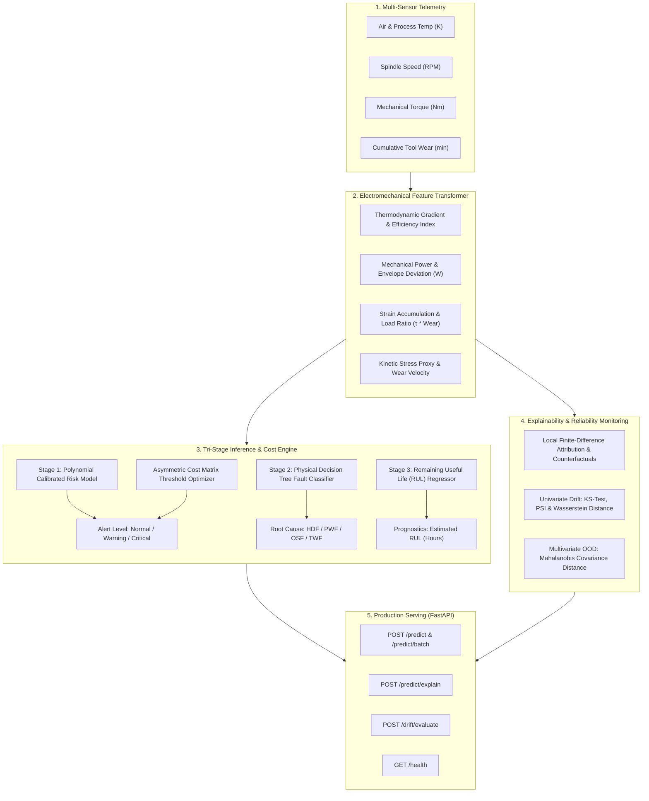

# Industrial Predictive Maintenance, RUL Prognostics & XAI Engine

[](https://github.com/yakupakcy36/industrial-predictive-maintenance/actions)
[](https://www.python.org/downloads/)
[](https://fastapi.tiangolo.com/)
[](https://opensource.org/licenses/MIT)

An end-to-end industrial Machine Learning platform for **equipment failure risk scoring, Remaining Useful Life (RUL) prognostics, root-cause multi-class fault diagnostics, Explainable AI (XAI) counterfactual recommendations, asymmetric cost optimization, and multivariate sensor drift detection**.

Built for high-throughput manufacturing execution systems (MES) and reliability engineering workflows to eliminate unplanned industrial downtime.

---

## 🏛️ System Architecture



---

## ⚙️ Physical Formulations & Prognostics

### 1. Failure Modes & Electromechanical Laws
* **Heat Dissipation Failure (HDF):**  
  $$\Delta T = T_{\text{process}} - T_{\text{air}} < 8.6\,\text{K} \quad \land \quad \omega < 1380\,\text{RPM}$$
* **Power Failure (PWF):**  
  $$P_{\text{mech}} = \tau \times \left(\frac{2\pi}{60} \times \text{RPM}\right) \notin [3500\,\text{W},\, 9000\,\text{W}]$$
* **Overstrain Failure (OSF):**  
  $$\text{Strain} = \tau \times \text{ToolWear} > 11{,}000\,\text{min}\cdot\text{Nm}$$
* **Tool Wear Failure (TWF):**  
  Cumulative contact fatigue entering critical wear zone ($\ge 200\,\text{min}$).

### 2. Asymmetric Maintenance Cost Optimization
Standard $\tau = 0.50$ probability thresholds ignore the asymmetry between a preventive inspection ($\$450$) and an unplanned catastrophic breakdown ($\$12{,}500$). The pipeline optimizes $\tau^*$ over out-of-fold validation predictions:

$$\tau^* = \arg\min_{\tau \in [0.15, 0.85]} \Big( N_{\text{FP}}(\tau) \cdot C_{\text{FP}} + N_{\text{FN}}(\tau) \cdot C_{\text{FN}} + N_{\text{TP}}(\tau) \cdot C_{\text{PM}} \Big)$$

### 3. Multivariate Telemetry Drift & Mahalanobis Distance
Alongside univariate **Kolmogorov-Smirnov ($p < 0.05$)**, **Population Stability Index ($\text{PSI}$)**, and **Wasserstein Earth Mover's Distance**, cross-sensor correlation shifts are tracked via **Mahalanobis Distance**:

$$D_M(\mathbf{x}) = \sqrt{(\mathbf{x} - \boldsymbol{\mu}_0)^\top \boldsymbol{\Sigma}_0^{-1} (\mathbf{x} - \boldsymbol{\mu}_0)}$$

---

## 📁 Repository Structure

```text
industrial-predictive-maintenance/
├── .github/workflows/ci.yml     # Automated GitHub Actions CI pipeline
├── src/
│   ├── config.py                # Physical constants, cost matrix, thresholds
│   ├── dataset.py               # Telemetry & Weibull RUL degradation generator
│   ├── features.py              # 10 physics & electromechanical features
│   ├── model.py                 # Tri-stage risk, diagnostic, RUL & XAI engine
│   ├── drift.py                 # KS, PSI, Wasserstein & Mahalanobis detector
│   └── pipeline.py              # CLI orchestrator (train, predict, evaluate)
├── api/
│   ├── schemas.py               # Strict Pydantic v2 data contracts
│   └── app.py                   # FastAPI service (/predict, /predict/explain, /drift)
├── tests/                       # Comprehensive unit & integration test suite
├── Dockerfile                   # Production container definition
├── docker-compose.yml           # Local service orchestration
└── requirements.txt
```

---

## 🚀 Quickstart & Reproduction

```bash
# 1. Install dependencies
pip install -r requirements.txt

# 2. Run tri-stage training & cost optimization pipeline
python -m src.pipeline train

# 3. Execute test suite
pytest -v

# 4. Launch production API
uvicorn api.app:app --host 0.0.0.0 --port 8000
```

---

## 📡 API Reference

### 1. Real-Time Prognostics: `POST /predict`
Returns calibrated failure probability, **Remaining Useful Life (`estimated_rul_hours`)**, diagnosed fault mode, and prescriptive action.

### 2. Explainable AI & Counterfactuals: `POST /predict/explain`
Computes local finite-difference sensor attributions and synthesizes an actionable counterfactual parameter adjustment (e.g., *"Adjusting torque_nm from 68.0 to 60.0 reduces failure probability from 89.4% to 21.3%"*).

### 3. Multivariate Drift Evaluation: `POST /drift/evaluate`
Computes per-sensor KS-test, PSI, Wasserstein distance, and fleet-level Mahalanobis out-of-distribution (OOD) fractions.

---

## 📄 License
MIT License.
